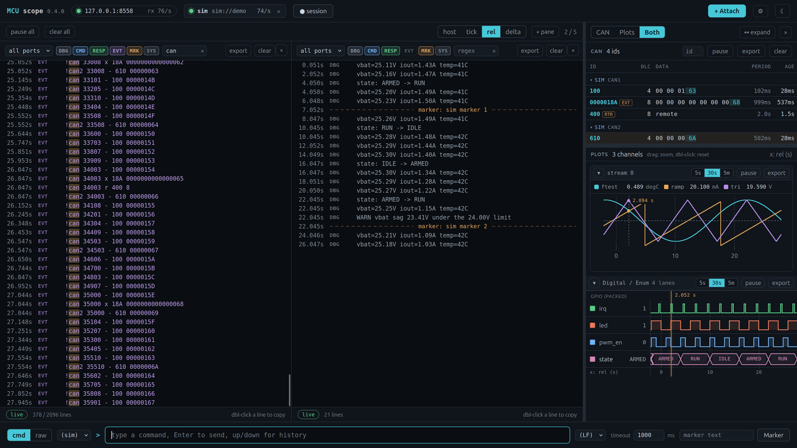

# MCUscope

[](https://github.com/dwatman/mcuscope/actions/workflows/ci.yml) [](https://pypi.org/project/mcuscope/) [](https://pypi.org/project/mcuscope/)

MCUscope is a debugging tool for microcontroller firmware that works over the UART your firmware already prints to.
A daemon on your PC records every line with a timestamp, and you and an AI agent such as Claude Code work from that one capture through a web UI and a command-line tool.

It is not a debug probe or an oscilloscope: it does not flash, halt or single-step the target.



In the web UI you can:

- **Watch output live** in one or more terminal panes, each filtered by port, channel and regex (left and centre).
- **Read CAN traffic as a table**: the latest frame per id, with its period and age (top right).
- **Plot values in real time**, with bit traces and state bands on the same time axis (bottom right).
- **Send commands and drop markers** from the bar along the bottom.
- **Attach serial ports, name a test run, change settings** from the top bar.
- **Export** any pane, table or chart to a file.

## Why

- **Nothing is lost.** Capture runs with no window open, into a SQLite database you can query by time, regex or test run.
- **No "port busy".** The daemon owns the serial port, so the web UI, the shell and an agent all use it at once.
- **Works with the firmware you have.** Plain `printf` output is enough. One line format adds plots, and an optional C module adds commands.
- **Made for scripts and AI agents.** You and an agent use the same CLI, with JSON output, exit codes, and commands that wait for a line or judge a whole run.

## Quick start

You need Python 3.10 or newer, on Linux or Windows (macOS is untested).
No board is needed for this part: a simulated MCU is built in.

```bash
uv tool install mcuscope        # or: pipx install mcuscope
mcu daemon start --sim --open  # start the daemon in the background with the simulator, open the web UI
```

The web UI is at **http://127.0.0.1:8558/ui/**.
Then:

```bash
mcu status                      # daemon and port health
mcu cmd 'i2c scan'              # ask the simulated board a question: prints 48 50
mcu tail -f                     # follow the live capture (Ctrl+C stops following)
mcu daemon stop                 # stop the daemon when you are done
```

- On Windows, run the examples in PowerShell: they use single quotes.
- To upgrade later: `uv tool upgrade mcuscope`, or `pipx upgrade mcuscope`.
- [Installing](docs/INSTALL.md) covers getting uv, an old or missing Python, and uninstalling.

## Use it with your board

You need a UART on the MCU that your PC can reach, through a USB-serial adapter or a debug probe's virtual COM port, and its baud rate.
Any firmware that prints lines works as it is.

```bash
mcu daemon start --open                                 # start the daemon in the background, open the web UI
```

Click **+ Attach** in the web UI and pick your serial port, or attach it from the shell:

```bash
mcu devices                                             # list serial devices
mcu attach /dev/ttyACM0 --baud 115200 --alias board     # on Windows: COM7
```

These work with any firmware:

```bash
mcu tail -f                                     # follow live output
mcu lines --match 'ERR|WARN' --last-ms 60000    # search the last minute
mcu wait --match 'ARMED -> RUN' --timeout 15000 # block until a line appears
mcu mark 'starting rail test'                   # annotate the capture
mcu log export --last-ms 60000 -o run.log       # save a window to a file
```

These need the optional monitor module in your firmware (next section):

```bash
mcu cmd 'i2c scan'                              # send a command, print the response
mcu can dump -n 20                              # recent CAN frames
```

- **Linux**: serial access needs your user in the `dialout` group (`sudo usermod -aG dialout $USER`, then log in again).
- **Windows**: some USB-serial adapters need their vendor driver.
- The daemon listens on `127.0.0.1` only. [LAN access](docs/CONFIGURATION.md#lan-access) says how to reach it from another machine.

The [user guide](docs/USAGE.md) covers the rest: sessions, exports, plots, CAN, pass/fail checks and scripting.

## What your firmware needs

| Level | Change to your firmware | What you get |
|---|---|---|
| 1. Plain text | none | timestamped capture, live terminal, search, sessions, export |
| 2. Plot lines | one `printf` format | realtime plots and timeline markers |
| 3. Monitor module | three C files and a small port file | commands and responses, CAN/I2C/SPI/GPIO/ADC access, typed plot streams |

A plot line looks like this:

```c
printf("!p %lu temp=%d.%02d rpm=%d\n", tick_ms, whole, frac, rpm);
```

[What your firmware needs to send](docs/FIRMWARE.md) explains each level, and the [integration guide](firmware/monitor/INTEGRATION.md) covers the monitor module.

## How it works

```
your MCU
  firmware that prints lines  (+ optional monitor module)
      |
      |  UART: plain text lines
      v
mcuscoped daemon on your PC
  owns the serial port
  timestamps every line into SQLite
      |
      |  local API on 127.0.0.1:8558
      |
      +--->  web UI      terminal, CAN table, realtime plots, settings
      +--->  mcu CLI     the same features from the shell, for you, scripts and agents
```

Protocol lines share the UART with your debug prints.
A leading `>` marks a command, `<` a response and `!` an event; every other line is debug output.

## AI agents

The `mcu` CLI is the agent interface.
An agent that can run shell commands can drive the hardware with the commands you use, and no MCP server or SDK is involved.

- Because the daemon stores everything, an agent can act and then query what happened, without holding a terminal open.
- `mcu wait` blocks until a line appears, and `mcu assert` turns a run into a pass or fail exit code.
- `mcu ai-guide` prints a reference written for agents.
- [CLAUDE_SNIPPET.md](docs/CLAUDE_SNIPPET.md) is a block to paste into your project's `CLAUDE.md`, so Claude Code knows the bridge is there.

## Documentation

| Page | Read it to |
|---|---|
| [Installing](docs/INSTALL.md) | fix an install, upgrade, or get serial port access |
| [User guide](docs/USAGE.md) | do a specific thing with the web UI or the CLI |
| [Configuration](docs/CONFIGURATION.md) | change a default, keep ports across restarts, run several daemons, use it over the LAN |
| [Firmware](docs/FIRMWARE.md) | decide what, if anything, to add to your firmware |
| [Monitor integration](firmware/monitor/INTEGRATION.md) | add the C monitor module to a project |
| [Specification](docs/SPEC.md) | look up the wire protocol, the REST and WebSocket API, or the database schema |
| [Development](docs/DEVELOPMENT.md) | build from source, run the tests, find the design documents |

## Status

MCUscope is in beta (0.x) and in regular use against real hardware.
Interfaces may still change between minor releases; the [changelog](CHANGELOG.md) flags breaking changes.
CI runs the full test suite on Linux and Windows with Python 3.10 to 3.13.

Report problems on the [issue tracker](https://github.com/dwatman/mcuscope/issues).

## License

[MIT](LICENSE)
