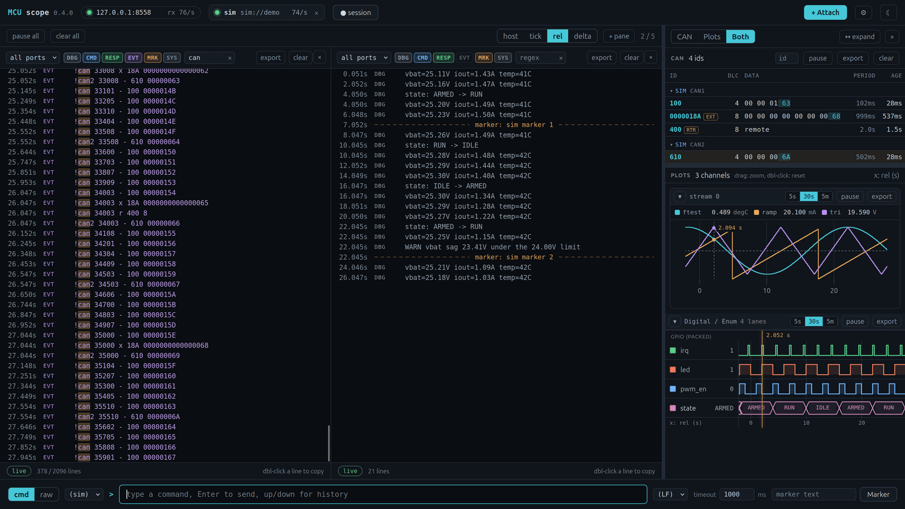

# MCUscope

MCUscope is a debugging tool for microcontroller firmware that works over the UART your firmware already prints to.
A daemon on your PC records every line with a timestamp, and you and an AI agent such as Claude Code work from that one capture through a web UI and a command-line tool.

It is not a debug probe or an oscilloscope: it does not flash, halt or single-step the target.

<!-- Absolute URLs on purpose: PyPI does not resolve repo-relative paths. -->



In the web UI you can:

- **Watch output live** in one or more terminal panes, each filtered by port, channel and regex (left and centre).
- **Read CAN traffic as a table**: the latest frame per id, with its period and age (top right).
- **Plot values in real time**, with bit traces and state bands on the same time axis (bottom right).
- **Send commands and drop markers** from the bar along the bottom.
- **Attach serial ports, name a test run, change settings** from the top bar.
- **Export** any pane, table or chart to a file.

## Why

- **Nothing is lost.** Capture runs with no window open, into a SQLite database you can query by time, regex or test run.
- **No "port busy".** The daemon owns the serial port, so the web UI, the shell and an agent all use it at once.
- **Works with the firmware you have.** Plain `printf` output is enough. One line format adds plots, and an optional C module adds commands.
- **Made for scripts and AI agents.** You and an agent use the same CLI, with JSON output, exit codes, and commands that wait for a line or judge a whole run.

## What you need

- Python 3.10 or newer, on Linux or Windows 10/11 (macOS is untested).
- For a real board: a UART your PC can reach, through a USB-serial adapter or a debug probe's virtual COM port.
- Nothing in your firmware, to start with. Any firmware that prints lines works as it is.
  - An optional C module adds commands and CAN/I2C/SPI/GPIO/ADC access. It lives in the [repository](https://github.com/dwatman/mcuscope/blob/main/firmware/monitor/README.md), not in this package.

## Install

```bash
uv tool install mcuscope        # or: pipx install mcuscope
```

This installs three commands: `mcuscoped` (the daemon), `mcu` (the CLI) and `mcu-sim` (a simulated MCU).

If `mcuscoped` is not found, run `uv tool update-shell` (or `pipx ensurepath`) and open a new terminal.

To upgrade later: `uv tool upgrade mcuscope`, or `pipx upgrade mcuscope`.

## Try it with no hardware

```bash
mcu daemon start --sim --open  # start the daemon in the background with the simulator, open the web UI
```

The web UI is at **http://127.0.0.1:8558/ui/**.
Then:

```bash
mcu status                      # daemon and port health
mcu cmd 'i2c scan'              # ask the simulated board a question: prints 48 50
mcu tail -f                     # follow the live capture (Ctrl+C stops following)
mcu daemon stop                 # stop the daemon when you are done
```

On Windows, run the examples in PowerShell: they use single quotes.

## With a board

```bash
mcu daemon start --open                                 # start the daemon in the background, open the web UI
mcu devices                                             # list serial devices
mcu attach /dev/ttyACM0 --baud 115200 --alias board     # on Windows: COM7
```

- **Linux**: serial access needs your user in the `dialout` group (`sudo usermod -aG dialout $USER`, then log in again).
- **Windows**: some USB-serial adapters need their vendor driver.

## AI agents

The `mcu` CLI is the agent interface: an agent that can run shell commands drives the hardware with the commands you use.
`mcu ai-guide` prints a reference written for agents, and [CLAUDE_SNIPPET.md](https://github.com/dwatman/mcuscope/blob/main/docs/CLAUDE_SNIPPET.md) is a block to paste into a project's `CLAUDE.md`.

## Documentation

- [Overview](https://github.com/dwatman/mcuscope/blob/main/README.md)
- [Installing](https://github.com/dwatman/mcuscope/blob/main/docs/INSTALL.md): troubleshooting, upgrading, serial port access
- [User guide](https://github.com/dwatman/mcuscope/blob/main/docs/USAGE.md): the web UI and the `mcu` commands, by task
- [Configuration](https://github.com/dwatman/mcuscope/blob/main/docs/CONFIGURATION.md): the config file, several daemons, LAN access
- [Firmware](https://github.com/dwatman/mcuscope/blob/main/docs/FIRMWARE.md): what your firmware needs to send
- [Monitor integration](https://github.com/dwatman/mcuscope/blob/main/firmware/monitor/INTEGRATION.md): adding the C module to a project
- [Specification](https://github.com/dwatman/mcuscope/blob/main/docs/SPEC.md): wire protocol, API, database schema
- [Changelog](https://github.com/dwatman/mcuscope/blob/main/CHANGELOG.md)

## License

MIT
